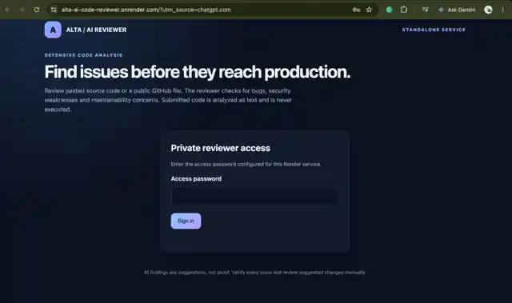
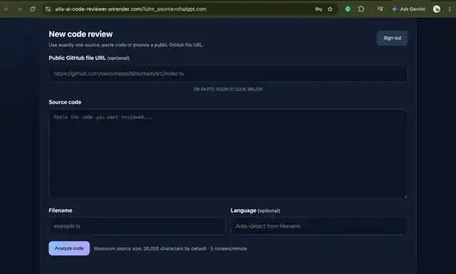

# Project 3 — Standalone AI Code Reviewer

A milestone from my AI development challenge: I designed, built, and deployed a separate AI-assisted code-review MVP.

**Live application:** https://alta-ai-code-reviewer.onrender.com  
**Source code:** [ai-code-reviewer folder](https://github.com/simarwin0/Alta-builders-30/tree/feature/standalone-ai-code-reviewer/ai-code-reviewer)

## What I built

- A private, password-protected reviewer interface.
- Code input by pasting source code or supplying a public GitHub file URL.
- OpenAI Responses API integration with structured JSON output.
- Findings organized into bugs, security concerns, and maintainability/style issues.
- Severity, evidence-based descriptions, line references where available, suggested fixes, and confidence scores.
- Defensive request handling: submitted source is treated as untrusted text and is never executed.
- Basic safeguards including request-size limits, login/review rate limits, Helmet security headers, same-origin checks, and secure session cookies in production.
- A standalone Render deployment, kept separate from the chat application's backend and database.

## Technology

- Node.js and Express
- OpenAI API
- HTML, CSS, and browser JavaScript
- Render Web Services
- GitHub

## Current scope

This is a working MVP milestone, not yet a full enterprise code-review platform.

Current input support is pasted code or **one public GitHub file** at a time, with a default maximum of 30,000 characters. The service does not currently support private repositories, whole-repository scans, pull-request reviews, review-history storage, multi-user accounts, static-analysis engines, or automated test execution. AI findings are suggestions and must be checked by a developer.

The deployment and browser workflow are confirmed. A successful end-to-end response from the live OpenAI review endpoint still needs to be validated with a real test submission.

## Screenshots

### 1. Private reviewer sign-in

### 2. Authenticated code-review workspace

These screenshots show the login screen and the dashboard after sign-in. They do not show a completed AI-generated review report. No credentials or API keys are included.

## Security and configuration

The service uses `OPENAI_API_KEY` and `REVIEWER_ACCESS_PASSWORD` in the Render service's private environment settings. Secret values are intentionally not stored in this repository or in screenshots. The access password is not included in this README.

## What I learned

This project helped me practise connecting an LLM API to a real web application, designing structured model output, adding practical request protections, separating services, and deploying a Node.js app to a cloud platform.

## Next milestones

1. Verify a real AI review against a controlled sample file.
2. Add repository-level analysis with safe file filtering and size limits.
3. Explore authenticated GitHub integration for pull-request reviews.
4. Add automated tests, persistent review reports, and stronger user authentication.
5. Add static-analysis and dependency-scanning integrations.

---

Built as part of my hands-on AI engineering challenge.
