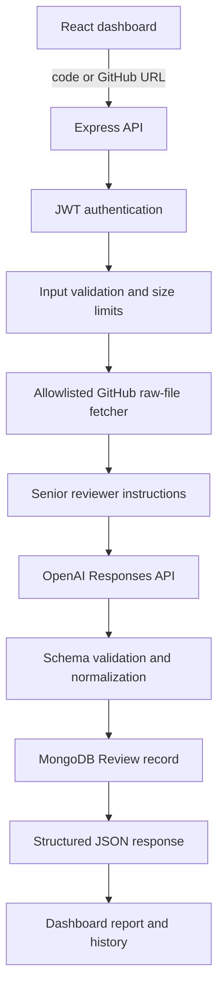

# AI Code Reviewer — System Architecture

## Objective
A full-stack code review application that accepts pasted source code or a public GitHub file URL, analyzes it with the OpenAI Responses API, and returns a validated JSON report covering bugs, style/maintainability, and security.

## High-level flow



## Components

- **Web client**: React + Vite dashboard. Sends code or a GitHub file URL to the API, renders findings by severity, and displays review history.
- **API**: Node.js + Express. Validates request bodies, applies security headers, CORS policy, rate limits and request timeouts.
- **Input resolver**: Accepts exactly one of `code` or `githubUrl`. GitHub URLs are parsed and normalized to `raw.githubusercontent.com`; only public GitHub file URLs are accepted. Redirects are disabled, response size and content type are checked, and private/local hosts are rejected.
- **Reviewer service**: Calls the OpenAI Responses API with a fixed reviewer instruction and untrusted code clearly delimited as data. It never executes submitted code.
- **Output validator**: Parses model output and validates it against a strict schema. Invalid or incomplete model output fails closed with a safe API error rather than being passed to the UI as trusted data.
- **Persistence**: MongoDB stores the authenticated user's review metadata, source, code snapshot (subject to retention settings), and validated report. Every history query is scoped to the authenticated user.
- **Authentication**: Reuse the existing Track A JWT middleware only after verifying its token payload and request-user contract. Do not duplicate or weaken auth checks.

## API contract

### `POST /api/test-llm`
Development-only connectivity check. Requires a configured server-side `OPENAI_API_KEY`. Returns a small model response and never returns the key.

### `POST /api/reviews/analyze`
Authenticated. Accepts either:
```json
{ "code": "const answer = 42;", "language": "javascript", "filename": "example.js" }
```
or:
```json
{ "githubUrl": "https://github.com/owner/repo/blob/main/src/index.ts" }
```

Returns:
```json
{
  "summary": "Short review summary",
  "overallRisk": "Low",
  "findings": [
    {
      "category": "bug",
      "severity": "Medium",
      "title": "Example issue",
      "description": "Why it matters",
      "line": 12,
      "suggestedFix": "Use a validated value",
      "confidence": 0.92
    }
  ],
  "positives": ["Clear separation of concerns"]
}
```

### `GET /api/reviews/history`
Authenticated and paginated. Returns only records owned by the current user.

## Security and privacy controls

1. Keep `OPENAI_API_KEY`, `MONGODB_URI`, and `JWT_SECRET` on the server. Never use a `VITE_*` variable for secrets.
2. Treat code as hostile, untrusted text. Do not run, compile, import, or evaluate it.
3. Defend GitHub fetching against SSRF: HTTPS only, exact GitHub host allowlist, reject credentials and non-file URLs, no redirects, bounded response bytes and timeouts.
4. Enforce request size and code length limits before model calls.
5. Use JWT authentication for analysis/history and scope all database reads/writes by user ID.
6. Apply per-user rate limits, Helmet, strict CORS, timeouts, and generic production errors.
7. Avoid logging source code, tokens, prompts containing user code, or secrets. Log request IDs, latency, model name and usage metadata only.
8. Make retention explicit. Users should be able to delete saved reviews; do not claim database encryption is end-to-end encryption.
9. Validate all model output. Treat the model as fallible and label findings with confidence; the report is advisory, not a substitute for human review.

## Production deployment topology

The production reviewer routes are mounted inside the existing Track A API at `backend/src/routes/aiReviews.ts`. This is intentional: Track A uses a host-only `__Host-chat_session` HttpOnly cookie, so a separate Render hostname cannot receive that cookie. The shared backend preserves the exact authentication/session-version checks and existing CORS/CSRF protections.

- **Backend**: deploy the existing Track A Render service from the repository root `render.yaml` (its build/start commands use `backend/`). The blueprint now includes `OPENAI_API_KEY`, `OPENAI_MODEL`, and `MAX_REVIEW_CODE_CHARS`.
- **Frontend**: Vercel project root `ai-code-reviewer/frontend`, build `npm run build`, output `dist`.
- Set `VITE_API_BASE_URL` to the same Render API origin used by Track A login. Do not point production at the standalone reviewer service.
- Set Render `CLIENT_ORIGIN` to the exact Vercel origin. Keep the OpenAI key only in Render.
- `ai-code-reviewer/backend` is an isolated local development/test harness; production authentication and persistence use the integrated Track A backend.

## Initial decisions

- TypeScript throughout the backend.
- OpenAI Responses API (not the retired Assistants API) for new model requests.
- JSON Schema constrained output plus runtime validation.
- MongoDB/Mongoose for review history.
- The feature is isolated under `ai-code-reviewer/` so it does not disrupt the existing Track A chat application.
